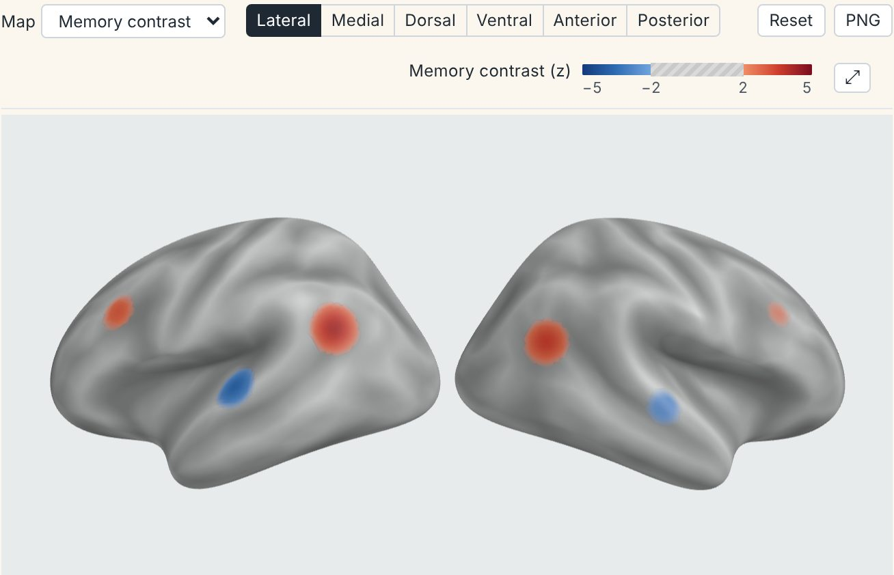

<!-- README.md is generated from README.Rmd. Please edit that file -->

```{r, include = FALSE}
knitr::opts_chunk$set(
  collapse = TRUE,
  comment = "#>",
  fig.path = "man/figures/README-"
)
options(rgl.useNULL = TRUE)
```

# neurosurf

[](https://bbuchsbaum.r-universe.dev/neurosurf)
[](https://github.com/bbuchsbaum/neurosurf/actions/workflows/R-CMD-check.yaml)
[](https://github.com/bbuchsbaum/neurosurf/actions/workflows/coverage.yaml)

**Cortical surface data in R: read meshes, keep values on their vertices,
and turn them into publication figures and interactive reports.**

neurosurf reads FreeSurfer, GIFTI and AFNI/SUMA surfaces, analyses data on
the mesh (smoothing, geodesic distance, clusters, searchlights), and draws
it. Static figures come from a deterministic CPU renderer that needs no
OpenGL device or browser, so the same code gives the same pixels on a
laptop, a cluster node or CI. Interactive reports bundle their own viewer and
need no network access.

[Documentation](https://bbuchsbaum.github.io/neurosurf/) ·
[Articles](https://bbuchsbaum.github.io/neurosurf/articles/) ·
[Reference](https://bbuchsbaum.github.io/neurosurf/reference/index.html) ·
[News](NEWS.md)

> **Status:** pre-release, not yet on CRAN. Interfaces may still change.

## Installation

```{r install-universe, eval = FALSE}
# Prebuilt binaries from r-universe
install.packages("neurosurf",
  repos = c("https://bbuchsbaum.r-universe.dev", "https://cloud.r-project.org")
)

# Or the development version from GitHub (needs a C++ toolchain)
# install.packages("remotes")
remotes::install_github("bbuchsbaum/neurosurf")
```

## A publication figure in one call

The fsaverage5 template ships with the package: surfaces, sulcal depth for
the grey anatomy, and a cortex mask that keeps colour off the medial wall.
Given one value per vertex for each hemisphere, `surface_figure()` draws
lateral and medial views of both with one shared colour scale.

```{r load, message = FALSE}
library(neurosurf)
inflated <- load_fsaverage("fsaverage5", "inflated")
```

<details>
<summary>Example data: a synthetic <i>z</i> map (any numeric vector with one value per vertex works)</summary>

```{r example-data, message = FALSE}
white <- load_fsaverage("fsaverage5", "white")

# Smooth clusters placed at white-surface coordinates, falling off with
# distance over the inflated surface.
zmap <- function(hemi, side) {
  cluster <- function(centre, z, width = 10) {
    seed <- which.min(colSums((t(coords(white[[hemi]])) - centre)^2))
    xyz <- coords(inflated[[hemi]])
    z * exp(-colSums((t(xyz) - xyz[seed, ])^2) / (2 * width^2))
  }
  cluster(c(45 * side, -60, 20), 4) + cluster(c(40 * side, 20, 30), 3) +
    cluster(c(55 * side, -20, 0), -3.5) + cluster(c(5 * side, -46, 22), -3)
}
z <- list(lh = zmap("lh", -1), rh = zmap("rh", 1))
```

</details>

```{r quickstart, message = FALSE, fig.alt = "Lateral and medial views of both fsaverage5 hemispheres with red and blue thresholded z-map clusters over grey sulcal shading; the medial wall carries no colour", fig.width = 7, fig.height = 5.4, dpi = 150, out.width = "100%"}
fig <- surface_figure(
  lh = inflated$lh, rh = inflated$rh, values = z,
  anatomy = load_fsaverage_sulc("fsaverage5"),
  cortex_mask = load_fsaverage_cortex("fsaverage5"),
  threshold = 1.5, limits = c(-4, 4), legend_title = "z"
)
plot(fig)
```

`write_surface_figure(fig, "figure.png")` saves it. For a layout of your own,
render single panels with `render_surface_rgba()` and arrange them, with the
same colour key, using `surface_panels()`.

## An interactive report from the same values

```{r viewer, eval = FALSE}
scene <- surface_scene(
  left = inflated$lh, right = inflated$rh,
  layers = surface_layer(
    "z", list(left = z$lh, right = z$rh),
    colormap = surface_palette("two_sided", limits = c(-4, 4), threshold = 1.5),
    limits = c(-4, 4), threshold = c(-1.5, 1.5), units = "z"
  ),
  fallback = "Bilateral cortical surfaces with a thresholded z map.",
  alt_text = "Inflated left and right hemispheres with red and blue clusters."
)
surfwidget(scene)                      # in R Markdown, Quarto or Shiny
write_surface_scene(scene, "report")   # or as a standalone web page
```



A scene holds both hemispheres and any number of named maps; readers switch
maps, views and reference regions from the toolbar. `surface_palette()` gives
the viewer exactly the colours the static figure uses.

## Which function do I need?

| You want | Use |
|---|---|
| A finished static figure: views × hemispheres, one colour key | `surface_figure()`, `write_surface_figure()` |
| One panel, or small multiples you lay out | `render_surface_rgba()`, `surface_panels()` |
| An interactive figure in a report, Shiny app or web page | `surface_scene()`, `surfwidget()`, `write_surface_scene()` |
| To rotate a surface in your R session | `view_surface()`, `plot()` |
| To read surfaces and data | `read_surf()`, `read_surf_geometry()`, `load_fsaverage()` |
| To map a volume onto the cortex | `vol_to_surf()`, `vol_to_surf_sdf()` |
| To analyse on the mesh | `smooth()`, `geodesic_distances()`, `cluster_threshold()`, `SurfaceSearchlight()` |

Volumetric data structures come from
[neuroim2](https://github.com/bbuchsbaum/neuroim2).

## Learn more

- [Introduction to neurosurf data structures](https://bbuchsbaum.github.io/neurosurf/articles/introduction-to-neurosurf.html):
  geometry, vertex data and the core classes.
- [Publication-quality surface figures](https://bbuchsbaum.github.io/neurosurf/articles/surface-figures.html):
  thresholds, colour keys, cortex masks and medial-wall policies.
- [Bilateral interactive surface reports](https://bbuchsbaum.github.io/neurosurf/articles/interactive-surfaces.html):
  scenes, several maps, reference regions and offline reports.
- [Displaying surfaces with rgl](https://bbuchsbaum.github.io/neurosurf/articles/displaying-surfaces.html):
  interactive exploration from an R session.

## Contributing

Bug reports and pull requests are welcome on the
[issue tracker](https://github.com/bbuchsbaum/neurosurf/issues). See
[CONTRIBUTING.md](CONTRIBUTING.md), including how to rebuild the bundled
JavaScript viewer. The Coverage badge reports whether the coverage workflow
ran; its summary lists the measured coverage per file.

## License

GPL (>= 2). The bundled fsaverage templates are redistributed under the
FreeSurfer licence; see `inst/extdata/PROVENANCE.md`.
