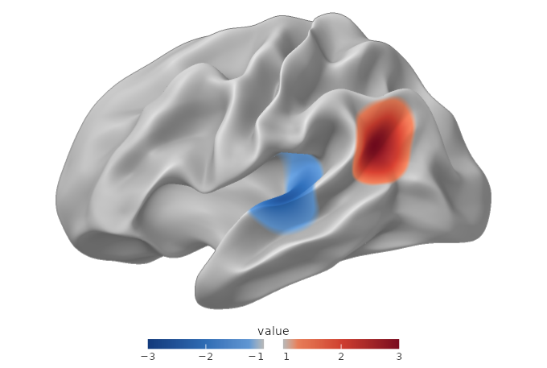
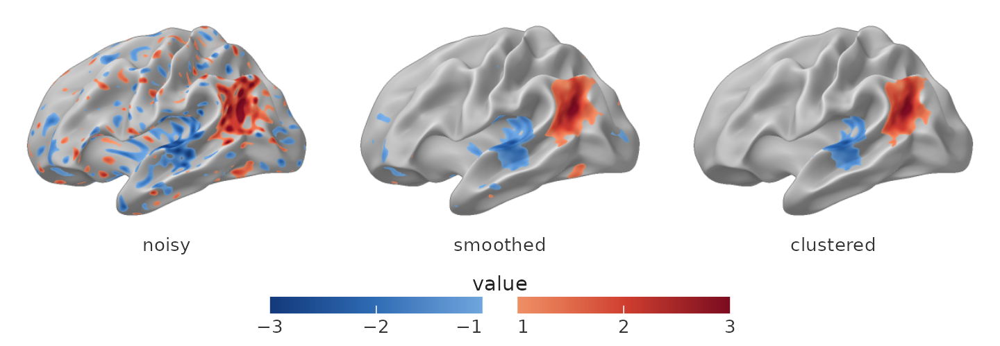

# Displaying Surfaces with RGL

This article shows how to display cortical geometry, curvature, and
vertex values with RGL. It uses the small `std.8` surfaces bundled with
neurosurf, so no downloads are needed. Every RGL scene below is an
interactive WebGL widget: drag to rotate, scroll to zoom. Static figures
use neurosurf’s CPU renderer, which needs no OpenGL.

The `std.8` template has 642 vertices per hemisphere, about 10 mm apart.
RGL colours each vertex and blends across triangles, so on a mesh this
coarse a thresholded map gets jagged edges. One round of Loop
subdivision (2,562 vertices) and the fade
[`view_surface()`](https://bbuchsbaum.github.io/neurosurf/reference/view_surface.md)
applies at the threshold keep them smooth enough for display:

``` r

library(neurosurf)

refine <- function(geometry) {
  mesh <- Rvcg::vcgSubdivide(geometry@mesh, threshold = 0,
                             type = "Loop", iterations = 1,
                             silent = TRUE)
  SurfaceGeometry(t(mesh$vb[1:3, ]), t(mesh$it) - 1L, geometry@hemi)
}
std8 <- load_fsaverage_std8("smoothwm")
left <- refine(std8$lh)
right <- refine(std8$rh)
inflated_lh <- refine(load_fsaverage_std8("inflated")$lh)
anatomy <- curvature(left)
```

For values, two smooth clusters of opposite sign stand in for a
statistic map. Each is placed at a surface coordinate and falls off with
distance over the inflated surface, which follows the cortical sheet:

``` r

blob <- function(centre, peak, width = 15) {
  seed <- which.min(colSums((t(coords(left)) - centre)^2))
  xyz <- coords(inflated_lh)
  peak * exp(-colSums((t(xyz) - xyz[seed, ])^2) / (2 * width^2))
}
vertex_values <- blob(c(-45, -60, 20), 3) +  # parietal, positive
  blob(c(-55, -20, 0), -2.5)                 # temporal, negative
```

## Open a scene and show it

[`view_surface()`](https://bbuchsbaum.github.io/neurosurf/reference/view_surface.md)
draws into the current RGL device when `new_window = FALSE`. This helper
gives each example a private NULL device, returns the scene as a WebGL
widget, and closes the device even if the plotting call fails. In an
interactive session, use
[`rgl::open3d()`](https://dmurdoch.github.io/rgl/dev/reference/open3d.html)
to get a desktop window instead.

``` r

with_rgl_scene <- function(code) {
  device <- rgl::open3d(useNULL = TRUE)
  on.exit(rgl::close3d(device), add = TRUE)
  force(code)
  rgl::rglwidget()
}
```

A `SurfaceGeometry` records its hemisphere, so `viewpoint = "lateral"`
selects the appropriate left or right view. By default the surface is
shaded by its curvature, sulci dark and gyri light; `bgcol` replaces
that base colour.

``` r

with_rgl_scene(
  view_surface(left, viewpoint = "lateral", zoom = 0.7,
               new_window = FALSE)
)
```

## Overlay values

Pass vertex values in `vals`. `irange` sets the colour limits and
`thresh = c(-1, 1)` leaves values inside that band uncoloured, so the
curvature shows through; colour fades in just past the threshold. Signed
values get neurosurf’s diverging palette,
`surface_palette("two_sided")`: blue below zero, red above, with no
white centre to fade into the grey anatomy. Pass `cmap` to choose
another.

``` r

with_rgl_scene(
  view_surface(left, vals = vertex_values, irange = c(-3, 3),
               thresh = c(-1, 1), viewpoint = "lateral", zoom = 0.7,
               new_window = FALSE)
)
```

Colour limits are ±3 and \|value\| \< 1 is uncoloured: blue negative,
red positive. On a folded surface parts of each cluster lie in sulcal
banks hidden from this view, so their edges look clipped; statistical
maps are usually shown on the inflated surface, as in
[Publication-quality surface
figures](https://bbuchsbaum.github.io/neurosurf/articles/surface-figures.html).
For a static figure with a colour key, use
[`surface_figure()`](https://bbuchsbaum.github.io/neurosurf/reference/surface_figure.md).
It renders the same values with the CPU renderer, which interpolates
within each triangle, so its lighting and colour mapping do not depend
on RGL.

``` r

figure <- surface_figure(
  lh = left, values = vertex_values, anatomy = anatomy,
  views = "lateral", threshold = 1, limits = c(-3, 3),
  alpha_ramp = 0.25, legend_title = "value",
  panel_width = 680, panel_height = 400, antialias = 2
)
```



## Vertex colours

`vert_clrs` supplies one explicit colour per vertex and overrides scalar
colour mapping, for example to show a parcellation. Here the anterior
half of the hemisphere (positive y) is green and the posterior half
purple. `alpha` blends these colours with the curvature shading beneath,
so the folds stay visible.

``` r

y <- coords(left)[, 2]
halves <- ifelse(y > median(y), "#1b7837", "#762a83")
with_rgl_scene(
  view_surface(left, vert_clrs = halves, alpha = 0.6,
               viewpoint = "lateral", zoom = 0.7, new_window = FALSE)
)
```

`specular` sets the highlight colour (the default `"black"` gives a
matte surface), and `lit` turns lighting on or off. These change the
displayed scene, not the stored geometry or vertex data.

## Combine hemispheres in one scene

The two lateral surfaces face opposite directions, so show them in
separate panels. A dorsal view sees both hemispheres at once, so they
can share one scene; `offset` separates them along x. Anterior is at the
top.

``` r

with_rgl_scene({
  view_surface(left, viewpoint = "dorsal", offset = c(-5, 0, 0),
               new_window = FALSE)
  view_surface(right, viewpoint = "dorsal", offset = c(5, 0, 0),
               zoom = 0.75, new_window = FALSE)
})
```

Other views are `"medial"`, `"ventral"`, `"anterior"` and `"posterior"`.
For static multi-view output,
[`surface_figure()`](https://bbuchsbaum.github.io/neurosurf/reference/surface_figure.md)
combines hemispheres and labels each view; see [Publication-quality
surface
figures](https://bbuchsbaum.github.io/neurosurf/articles/surface-figures.html).

## Mark vertices and plot a surface data object

`NeuroSurface` stores values with the vertex indices they belong to (it
can also hold a subset of vertices). Its
[`plot()`](https://rdrr.io/r/graphics/plot.default.html) method passes
them to
[`view_surface()`](https://bbuchsbaum.github.io/neurosurf/reference/view_surface.md),
so the same threshold and fade apply. Markers refer to vertices too:
these sit on the peak vertex of each cluster.

``` r

surface <- NeuroSurface(left, indices = nodes(left),
                        data = vertex_values)
peaks <- data.frame(
  vertex = c(which.max(vertex_values), which.min(vertex_values)),
  radius = 2.5, color = "#1f2933"
)
with_rgl_scene(
  plot(surface, irange = c(-3, 3), thresh = c(-1, 1),
       spheres = peaks,
       spheres_as_vertices = TRUE, viewpoint = "lateral", zoom = 0.7,
       new_window = FALSE)
)
```

## Smooth and threshold a noisy map

Smoothing and cluster-size thresholding operate on surface data before
rendering. Here noise is added to the two clusters, averaged over a 5 mm
geodesic radius (`sigma`), and thresholded at \|value\| \> 1. Smoothing
recovers the two known clusters but leaves small specks of noise;
[`cluster_threshold()`](https://bbuchsbaum.github.io/neurosurf/reference/cluster_threshold-methods.md)
removes every connected cluster smaller than 20 vertices.

``` r

set.seed(123)
noise <- rnorm(length(vertex_values))
noisy <- NeuroSurface(left, indices = nodes(left),
                      data = vertex_values + noise)
smoothed <- smooth(noisy, sigma = 5)
clustered <- cluster_threshold(smoothed, size = 20,
                               threshold = c(-1, 1))
```

Shown as small multiples with the same colour scale.
[`surface_panels()`](https://bbuchsbaum.github.io/neurosurf/reference/surface_panels.md)
lays out rendered panels in a row with labels and the shared key:

``` r

steps <- list(noisy = noisy, smoothed = smoothed,
              clustered = clustered)
panels <- lapply(steps, function(x) {
  render_surface_rgba(left, as.numeric(x@data),
                      anatomy_metric = anatomy,
                      camera = "lateral", threshold = 1,
                      limits = c(-3, 3), width = 420, height = 260,
                      antialias = 2)
})
surface_panels(panels, legend_title = "value")
```



[`surface_montage()`](https://bbuchsbaum.github.io/neurosurf/reference/surface_montage.md)
lays out RGL snapshots the same way; it needs a rendering backend, so it
is not run here:

``` r

surface_montage(list(noisy, smoothed, clustered), irange = c(-3, 3),
                thresh = c(-1, 1), ncol = 3)
```

## Save an RGL snapshot

[`snapshot_surface()`](https://bbuchsbaum.github.io/neurosurf/reference/snapshot_surface.md)
saves a PNG through the available RGL rendering backend. On a NULL
device it needs webshot2 and a headless browser, and it returns an empty
path when no snapshot could be made. Building this article does not
launch a browser, so this recipe is not run here:

``` r

file <- tempfile(fileext = ".png")
path <- snapshot_surface(left, file = file, vals = vertex_values,
                         irange = c(-3, 3), viewpoint = "lateral")
```

For browser-free PNG output, use
[`surface_figure()`](https://bbuchsbaum.github.io/neurosurf/reference/surface_figure.md)
or
[`render_surface_rgba()`](https://bbuchsbaum.github.io/neurosurf/reference/render_surface_rgba.md).
For interactive reports with several selectable maps, see [Build
bilateral interactive surface
reports](https://bbuchsbaum.github.io/neurosurf/articles/interactive-surfaces.html).

The bundled templates retain the FreeSurfer terms in
`system.file("extdata", "LICENSE-FreeSurfer.txt", package = "neurosurf")`.
